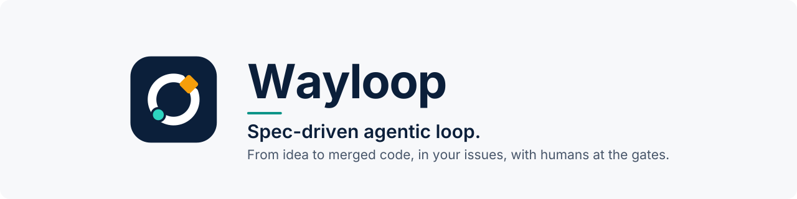

<!-- i18n source: README.md source_hash: b206f176fb06 -->

<a href="https://salvo8519.github.io/wayloop/it/">
  <picture>
    <source media="(prefers-color-scheme: dark)" srcset="docs/_shared/assets/brand/banner-dark.svg">
    
  </picture>
</a>

[English](README.md) · **Italiano**

<h3>Lo spec-driven agentic loop per interi progetti software.</h3>

I tuoi agenti scrivono il codice. Wayloop guida il progetto intorno — 
dall'idea al codice unito, dentro le tue issue, con le persone ai gate.

**[Documentazione](https://salvo8519.github.io/wayloop/it/)** ·
**[Come funziona il loop](https://salvo8519.github.io/wayloop/it/concepts/the-loop/)** ·
**[Architettura](https://salvo8519.github.io/wayloop/it/concepts/architecture/)** ·
**[Roadmap](https://salvo8519.github.io/wayloop/project/roadmap/)** ·
**[Contribuire](CONTRIBUTING.md)**

---

> Stato: pre-alpha. Non c'è ancora una release. Il progetto è registrato nelle
> [decisioni di architettura](https://salvo8519.github.io/wayloop/project/adr/) e nelle
> [specifiche](specs/README.md); ciò che viene dopo è nella
> [roadmap](https://salvo8519.github.io/wayloop/project/roadmap/).

## Perché Wayloop

Gli agenti di programmazione scrivono codice in fretta. I progetti però falliscono ancora nel
lavoro intorno al codice: intenti mai scritti, piani che si allontanano da ciò che viene
davvero costruito, sessioni che il prossimo agente non riesce a riprendere, costi che nessuno
misura.

Due famiglie di strumenti affrontano ciascuna metà del problema.

- **Gli strumenti spec-driven** fissano l'intento prima del codice, ma si fermano al file del
  piano.
- **I loop agentici** tengono un agente al lavoro finché l'obiettivo è raggiunto, ma non
  conoscono il piano del progetto su cui lavorano.

Wayloop è progettato per unire le due cose alla scala di un intero progetto: un motore
deterministico guida il loop, il piano vive nel tuo issue tracker e le persone decidono ai
gate. Il loop ha quattro movimenti: scomporre un'idea o un codice esistente in milestone, epic,
story, specifiche e issue; eseguire ogni issue con lo stesso ciclo; riconciliare ogni evento in
una proposta di modifica del piano; ripianificare dopo l'approvazione di una persona. Il
progetto è descritto in
[Come funziona il loop](https://salvo8519.github.io/wayloop/it/concepts/the-loop/).

## Installazione

Wayloop non ha ancora una release, quindi non c'è nulla da installare; il lavoro verso la
prima release è nella [roadmap](https://salvo8519.github.io/wayloop/project/roadmap/).

## Guida rapida

Non ancora disponibile: non c'è una release da eseguire; vedi la
[roadmap](https://salvo8519.github.io/wayloop/project/roadmap/).

## Usarlo da un agente AI

Non ancora disponibile: il motore non espone strumenti agli agenti; vedi la
[roadmap](https://salvo8519.github.io/wayloop/project/roadmap/).

## Comandi

Nessun comando è ancora rilasciato. Una build dai sorgenti risponde a `wayloop version` e
`wayloop steps` ([riferimento](https://salvo8519.github.io/wayloop/it/reference/)); i comandi
del loop sono nella [roadmap](https://salvo8519.github.io/wayloop/project/roadmap/).

## Architettura

Un solo motore decide; adattatori sottili traducono. Il motore non chiama mai un modello, e gli
agenti non scrivono mai lo stato a mano
([ADR 0001](https://salvo8519.github.io/wayloop/project/adr/0001-rust-engine-thin-adapters/)).

| Parte | Percorso | Cosa fa oggi |
| --- | --- | --- |
| Core | [`crates/wayloop-core`](crates/wayloop-core) | Libreria Rust senza I/O. Fissa il vocabolario del ciclo di un'issue: nove passi in ordine, i loro identificativi stabili e quale passo è uno stato di approvazione. |
| Riga di comando | [`crates/wayloop-cli`](crates/wayloop-cli) | Il binario `wayloop`, solo un adattatore: legge gli argomenti, chiama il core e stampa JSON. |
| Contenuti per agenti | [`.agents/`](.agents) | Ruoli e skill nel formato aperto Agent Skills, con mirror generati per Claude Code. Servono a costruire Wayloop stesso. |
| Processo | [`roadmap/`](roadmap), [`specs/`](specs), [`sprints/`](sprints), [`scripts/`](scripts) | Il piano come codice, sincronizzato con le issue di GitHub; specifiche con requisiti numerati; corsie degli sprint con percorsi disgiunti; i controlli eseguiti dalla CI. |

Dettagli in [Architettura](https://salvo8519.github.io/wayloop/it/concepts/architecture/).

## Il contratto del loop

Queste regole valgono per ogni parte di Wayloop. Vengono dalla
[costituzione](specs/constitution.md) e dalle decisioni di architettura, e cambiarne una
richiede un nuovo ADR e l'approvazione del maintainer.

1. **Decisioni deterministiche.** Tutta la logica di decisione vive nel core. Lo stesso stato
   e lo stesso evento producono sempre lo stesso stato successivo. Un modello non dichiara mai
   finito il proprio lavoro: lo fa un controllo deterministico.
2. **Contratti JSON.** Ogni ingresso e ogni uscita che attraversano il confine del motore sono
   JSON con uno schema versionato; una modifica incompatibile è una nuova versione, mai una
   modifica della vecchia. Un unico envelope per tutti i comandi, con codici di errore e codici
   di uscita stabili, è descritto
   nell'[ADR 0009](https://salvo8519.github.io/wayloop/project/adr/0009-contract-guidelines/).
3. **Gate.** Il loop non può superare gli stati di approvazione: il verbale del comitato, la
   roadmap, una specifica approvata, un merge. Gli agenti fanno domande sull'issue, in un
   formato fisso. Nel core di oggi, `merge` è il passo di approvazione del ciclo di un'issue.
4. **Ledger.** Il ledger è in sola aggiunta, concatenato da hash e scritto solo dal motore.
   Lo stato è una funzione del ledger e si verifica con il replay. Le uscite dei modelli entrano
   nello stato solo dopo la validazione dello schema.
5. **Il tracker è la base dati.** Il piano vive nelle issue, le specifiche nel repository. Un
   progetto resta leggibile senza Wayloop.
6. **Il costo si misura.** Ogni fase ha un budget di token. Niente embedding e niente vector
   store ([ADR 0004](https://salvo8519.github.io/wayloop/project/adr/0004-no-embeddings/)).

Lo stato di ogni decisione è
nell'[indice degli ADR](https://salvo8519.github.io/wayloop/project/adr/).

## Sviluppato in modo aperto, a partire dalle specifiche

Wayloop è costruito con il processo che descrive. Ogni modifica parte da un'issue della
[roadmap](roadmap/roadmap.yaml); il comportamento del motore parte da una specifica con
requisiti numerati ([`specs/`](specs/README.md)); le scelte strutturali partono da un ADR.
Agenti e persone seguono le stesse regole ([AGENTS.md](AGENTS.md)), e la CI controlla il piano,
le convenzioni, lo stile e la documentazione a ogni pull request.

- Comincia da [CONTRIBUTING.md](CONTRIBUTING.md).
- La documentazione è pubblicata in [inglese](https://salvo8519.github.io/wayloop/) e in
  [italiano](https://salvo8519.github.io/wayloop/it/), ricostruita a ogni modifica su `main`.
  Gli agenti possono leggere [`llms.txt`](https://salvo8519.github.io/wayloop/llms.txt).

## Licenza

[Apache License 2.0](LICENSE).
